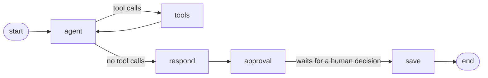

# Fixwright Enterprise AI Reliability & Integration Platform.

[](https://github.com/ozcivitcagkan/Fixwright-Enterprise-AI-Reliability-Integration-Platform/actions/workflows/tests.yml)

Fixwright is an enterprise-focused platform for incident management, system integrations, reliability workflows, and AI-assisted operational automation.

## Live Demo

The API is deployed at **https://fixwright.onrender.com**

- Interactive API docs: [fixwright.onrender.com/docs](https://fixwright.onrender.com/docs)
- Public health check: [fixwright.onrender.com/health](https://fixwright.onrender.com/health)
- All other endpoints require an API key in the `X-API-Key` header. A demo key is available on request.
- Hosting: Render (Docker container, Frankfurt) with a Neon serverless PostgreSQL database. Every merge to `main` is deployed automatically.
- The demo runs on free tiers, so the first request after 15 minutes of inactivity can take up to a minute while the service wakes up.

## Current Features

- REST API built with FastAPI
- PostgreSQL database integration
- Incident CRUD operations
- AI incident analysis agent built with LangGraph and Claude (tool calling, structured output)
- Human-in-the-loop approval: AI analyses are saved only after a person approves or rejects them
- Semantic search over past incidents (RAG) with pgvector and Voyage AI embeddings
- Approved analyses of similar incidents are reused as evidence; rejected ones are never shown to the agent
- Durable agent state with the LangGraph Postgres checkpointer
- API key authentication on every endpoint except the health check
- Pydantic request and response validation
- HTTP error handling
- Environment-based configuration
- Docker image and Docker Compose setup (API + PostgreSQL with pgvector)
- Automated tests with pytest against a real PostgreSQL test database
- CI with GitHub Actions on every pull request
- Dependabot for Python packages, the Docker base image, and GitHub Actions

## Tech Stack

- Python
- FastAPI
- PostgreSQL with pgvector
- Psycopg
- Pydantic
- LangGraph (with langgraph-checkpoint-postgres)
- LangChain (langchain-anthropic)
- Anthropic Claude (Haiku 5.5)
- Voyage AI embeddings (voyage-4)
- LangSmith (tracing)
- pytest
- Docker
- GitHub Actions
- Git
- GitHub

## Getting Started

1. Start PostgreSQL with pgvector in Docker (image `pgvector/pgvector:pg16-trixie`) and create a `.env` file with `DB_HOST`, `DB_PORT`, `DB_NAME`, `DB_USER`, `DB_PASSWORD`, `ANTHROPIC_API_KEY`, `VOYAGE_API_KEY`, and `FIXWRIGHT_API_KEY`.
2. Generate a random value for `FIXWRIGHT_API_KEY`: `python -c "import secrets; print(secrets.token_urlsafe(32))"`
3. Install dependencies: `pip install -r requirements.txt`
4. Create the tables, the pgvector extension, and the agent checkpoint tables (safe to run every time): `python -m app.db`
5. Optional: fill in embeddings for incidents that do not have one yet: `python -m app.backfill_embeddings`
6. Run the API: `uvicorn app.main:app --reload`

## Run with Docker

The API and PostgreSQL (with pgvector) can run together with Docker Compose. Only `ANTHROPIC_API_KEY`, `VOYAGE_API_KEY`, and `FIXWRIGHT_API_KEY` are read from `.env`; the database settings are defined in `docker-compose.yml`.

```bash
docker compose up --build
```

- On startup, the container creates the tables (`python -m app.db`), fills in missing incident embeddings (`python -m app.backfill_embeddings`), and then starts the API on port 8000. Both setup steps are safe to run every time. If Voyage AI is unavailable, the backfill is skipped and the API still starts.
- The image runs as a non-root user. `.env`, tests, and local files are kept out of the image by `.dockerignore`.
- Stop with `Ctrl+C`, then run `docker compose down`. Data stays in the `pgdata` volume.


## Authentication

Every endpoint except `GET /health` requires an API key in the `X-API-Key` header:

```bash
curl http://localhost:8000/incidents -H "X-API-Key: <your key>"
```

- A missing or wrong key returns `401` with a `WWW-Authenticate: APIKey` header.
- Keys are compared in constant time (`secrets.compare_digest`) to prevent timing attacks.
- If `FIXWRIGHT_API_KEY` is not set on the server, protected endpoints return `500` instead of opening up (fail closed).
- `GET /health` stays public so that deployment platforms can check the service.
- In the interactive docs (`/docs`), use the **Authorize** button to enter the key.

## API Endpoints

| Method | Endpoint | Description |
|---|---|---|
| GET | `/health` | Health check (also checks the database), public |
| POST | `/incidents` | Create an incident (its embedding is stored too) |
| GET | `/incidents` | Retrieve incidents |
| PUT | `/incidents/{incident_id}` | Update an incident (its embedding is refreshed) |
| DELETE | `/incidents/{incident_id}` | Delete an incident |
| POST | `/incidents/{incident_id}/analyze` | Run the AI agent and return an analysis waiting for approval |
| POST | `/analyses/{thread_id}/decision` | Approve or reject a pending analysis |

## AI Incident Analysis with Human Approval

An AI suggestion is not trusted on its own. The agent prepares an analysis, then pauses until a person approves or rejects it. Only then is the result written to the `incident_analyses` table.

**Step 1:** `POST /incidents/{incident_id}/analyze`

```json
{
  "thread_id": "3f2b...",
  "status": "pending_approval",
  "analysis": {
    "probable_cause": "...",
    "suggested_steps": ["..."],
    "evidence": ["..."]
  }
}
```

**Step 2:** `POST /analyses/{thread_id}/decision`

```json
{ "approved": true, "comment": "Matches what we saw last week" }
```

Response: `{"thread_id": "3f2b...", "status": "approved"}`

How it works:



- **agent**: Claude decides which tool to call next.
- **tools**: runs the requested tools against PostgreSQL:
  - `get_incident`: reads the incident.
  - `search_similar_incidents`: finds related past incidents by meaning with pgvector (see the next section).
- **respond**: turns the findings into a structured analysis using structured output.
- **approval**: pauses the graph with `interrupt()`. The graph state is stored in PostgreSQL by the checkpointer, so the decision can arrive in a later HTTP request, even after a restart.
- **save**: writes the analysis with its status (`approved` or `rejected`) and the reviewer's comment. Rejected analyses are kept as an audit trail.

Error handling:

- `404` from `/analyze` when the incident does not exist (the model is not called).
- `404` from `/decision` when the thread does not exist.
- `409` from `/decision` when the analysis was already decided.

Configuration:

- `ANTHROPIC_API_KEY` must be set in `.env` (never committed).
- The model ID, effort level, and output limit live in `app/config.py`.

Tests replace the model with a fake chat model, so the test suite and CI never call the real API. The database, tools, graph, and checkpointer still run for real.

## Similar Incident Search (RAG)

Keyword search misses incidents that describe the same problem in different words. The agent's `search_similar_incidents` tool searches by meaning instead:

1. When an incident is created or updated, its description is turned into a 1024-number vector (embedding) with Voyage AI and stored in the `incidents.embedding` column (pgvector, HNSW index with cosine distance).
2. During an analysis, the agent describes the problem in its own words. The tool embeds that query and asks PostgreSQL for the nearest incidents.
3. Each result includes a similarity score (0 to 1) and, if a person approved an analysis for that incident, its probable cause and suggested steps. Rejected analyses are never returned.
4. Results below a similarity threshold (`SIMILARITY_THRESHOLD` in `app/config.py`, currently 0.45) are left out, so the agent does not see unrelated incidents. The threshold was chosen with the retrieval evaluation described in the Evaluation section.

Example from a local run with the real models. The new incident shares almost no words with the old ones:

| Incident | Description | Similarity |
|---|---|---|
| INC-105 (new) | Salary batch did not finish overnight because the DB stopped answering | |
| INC-101 | Nightly payroll ETL job failed with a database timeout after 30 minutes (has an approved analysis) | 0.718 |
| INC-102 | Payroll ETL job timed out again; database CPU was at 95 percent during the run | 0.675 |
| INC-104 | Database timeout in the reporting service while an index rebuild was running | 0.621 |
| INC-103 | Login page returns HTTP 500 after the certificate renewal | below threshold, not returned |

The agent found INC-101, reused its approved probable cause as evidence, and stated that the cause was inferred from similar incidents and not yet confirmed for INC-105.

Design choices:

- **Vectors live in the same PostgreSQL database** as the incidents, so there is no separate vector store to run, back up, or keep in sync.
- **Voyage AI is called over its REST API with `httpx`** instead of the SDK, which keeps the Docker image small.
- **Embedding is not on the critical path:** if Voyage AI is down, the incident is still saved without a vector, and `python -m app.backfill_embeddings` (also run on every container start) fills it in later. If search is unavailable during an analysis, the tool returns an error and the agent reports thin evidence.
- **Tests use a fake embedding model** that gives texts with shared words similar vectors, so search ranking, the threshold, and the approved-only rule are tested without calling Voyage AI.

Configuration:

- `VOYAGE_API_KEY` must be set in `.env` (never committed).
- The embedding model, vector size, and similarity threshold live in `app/config.py`. The vector size must match `vector(1024)` in `db/schema.sql`.

## Observability (LangSmith Tracing)

Every agent run can be traced in LangSmith: each model call and tool call with its inputs and outputs, token usage, cost, and latency.

- Tracing is turned on with environment variables only. LangChain and LangGraph send the traces automatically, so there is no tracing code in the agent:

  ```
  LANGSMITH_TRACING=true
  LANGSMITH_API_KEY=<your key>
  LANGSMITH_PROJECT=fixwright-local
  ```

- Each run is named (`analyze_incident`, `decide_analysis`), tagged, and carries the `incident_id` as metadata, so all runs for one incident can be filtered.
- The test suite forces `LANGSMITH_TRACING=false`, so test runs with the fake model never reach LangSmith.

Example from one local analysis of INC-105: 4 model calls, 2 tool calls, about 10.8 seconds, about 6.8K tokens, and about $0.0013. The trace showed that the agent rephrased the incident before searching ("Overnight salary batch job did not finish because the database stopped responding") and that most of the time is spent in the last two model calls, which write the conclusion and then turn it into the structured report. Merging them is a candidate optimization.

## Evaluation

### Similar incident search

`evals/retrieval_eval.py` measures whether the search finds the right past incidents and which similarity threshold works best. It loads 16 labeled incidents (`evals/incidents.json`) into a separate `fixwright_eval` database, searches with 10 new incident descriptions written in different words (`evals/retrieval_cases.json`), and compares the results with the expected incidents. Two of the queries have no related incident, so the right answer for them is to return nothing.

```bash
python -m evals.retrieval_eval
```

It calls Voyage AI, so it runs on demand and is not part of the test suite or CI.

Results with voyage-4:

| Threshold | Precision | Recall | F1 |
|---|---|---|---|
| 0.40 | 0.56 | 1.00 | 0.72 |
| **0.45** | **0.71** | **0.94** | **0.81** |
| 0.50 | 0.88 | 0.83 | 0.86 |
| 0.55 | 1.00 | 0.61 | 0.76 |

- The threshold was raised from 0.40 to 0.45. F1 is highest at 0.50, but 0.45 was chosen on purpose: the model can ignore a weak match it sees, but it cannot use a relevant incident the search left out, so recall matters more than precision here.
- For both unrelated queries (a printer problem and a warehouse scanner problem), nothing is returned at 0.45.
- The set is small and the threshold was tuned on it, so the numbers are optimistic. The set should grow with real incidents and the threshold should be measured again.


## Architecture Roadmap

The platform is being developed toward an enterprise AI reliability architecture covering:

- AI-assisted incident analysis
- RAG-based knowledge retrieval
- Enterprise system integrations
- Reliable AI workflows
- Automated validation and testing
- Containerized services
- CI/CD pipelines
- Cloud infrastructure

## Status

Active Development

The core API, the database layer, the AI incident analysis agent, the human approval workflow, semantic search over past incidents with pgvector, and API key authentication are implemented.