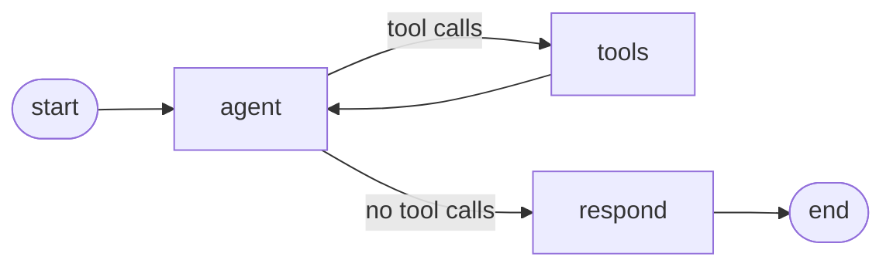

# Fixwright Enterprise AI Reliability & Integration Platform.

[](https://github.com/ozcivitcagkan/Fixwright-Enterprise-AI-Reliability-Integration-Platform/actions/workflows/tests.yml)

Fixwright is an enterprise-focused platform for incident management, system integrations, reliability workflows, and AI-assisted operational automation.

## Current Features

- REST API built with FastAPI
- PostgreSQL database integration
- Incident CRUD operations
- AI incident analysis agent built with LangGraph and Claude (tool calling, structured output)
- Pydantic request and response validation
- HTTP error handling
- Environment-based configuration
- Dockerized PostgreSQL
- Automated tests with pytest against a real PostgreSQL test database
- CI with GitHub Actions on every pull request

## Tech Stack

- Python
- FastAPI
- PostgreSQL
- Psycopg
- Pydantic
- LangGraph
- LangChain (langchain-anthropic)
- Anthropic Claude (Haiku 5.5)
- pytest
- Docker
- GitHub Actions
- Git
- GitHub

## API Endpoints

| Method | Endpoint | Description |
|---|---|---|
| GET | `/health` | Health check |
| POST | `/incidents` | Create an incident |
| GET | `/incidents` | Retrieve incidents |
| PUT | `/incidents/{incident_id}` | Update an incident |
| DELETE | `/incidents/{incident_id}` | Delete an incident |
| POST | `/incidents/{incident_id}/analyze` | Analyze an incident with the AI agent |

## AI Incident Analysis

`POST /incidents/{incident_id}/analyze` runs a LangGraph agent that investigates the incident and returns a structured analysis:

```json
{
  "probable_cause": "...",
  "suggested_steps": ["..."],
  "evidence": ["..."]
}
```

How it works:



- **agent**: Claude decides which tool to call next.
- **tools**: runs the requested tools against PostgreSQL:
  - `get_incident`: reads the incident.
  - `search_similar_incidents`: finds related past incidents by keyword (to be replaced by vector search with pgvector).
- **respond**: turns the findings into the final `AnalysisResult` using structured output.

The endpoint returns `404` without calling the model when the incident does not exist.

Configuration:

- `ANTHROPIC_API_KEY` must be set in `.env` (never committed).
- The model ID, effort level, and output limit live in `app/config.py`.

Tests replace the model with a fake chat model, so the test suite and CI never call the real API. The database, tools, and graph still run for real.

## Architecture Roadmap

The platform is being developed toward an enterprise AI reliability architecture covering:

- AI-assisted incident analysis
- RAG-based knowledge retrieval
- Enterprise system integrations
- Reliable AI workflows
- Automated validation and testing
- Containerized services
- CI/CD pipelines
- Cloud infrastructure

## Status

Active Development

The core API, the database layer, and the first version of the AI incident analysis agent are implemented.