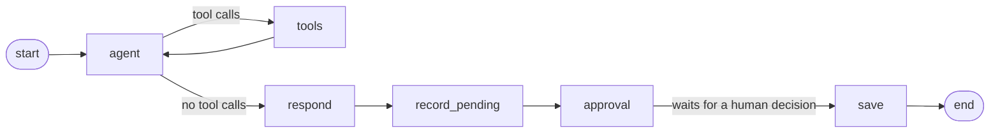

# Fixwright Enterprise AI Reliability & Integration Platform.

[](https://github.com/ozcivitcagkan/Fixwright-Enterprise-AI-Reliability-Integration-Platform/actions/workflows/tests.yml)

Fixwright is an enterprise-focused platform for incident management, system integrations, reliability workflows, and AI-assisted operational automation.

## Live Demo

The API is deployed at **https://fixwright.onrender.com**

- Interactive API docs: [fixwright.onrender.com/docs](https://fixwright.onrender.com/docs)
- Public health check: [fixwright.onrender.com/health](https://fixwright.onrender.com/health)
- Every other endpoint needs either an API key in the `X-API-Key` header (a demo key is available on request) or a signed-in browser session. See [Authentication](#authentication).
- Hosting: Render (Docker container, Frankfurt) with a Neon serverless PostgreSQL database. Every merge to `main` is deployed automatically.
- The demo runs on free tiers, so the first request after 15 minutes of inactivity can take up to a minute while the service wakes up.

## Current Features

- REST API built with FastAPI
- PostgreSQL database integration
- Incident CRUD operations
- AI incident analysis agent built with LangGraph and Claude (tool calling, structured output)
- Human-in-the-loop approval: every AI analysis is stored as pending and becomes approved or rejected only through a person's decision
- Semantic search over past incidents (RAG) with pgvector and Voyage AI embeddings
- Approved analyses of similar incidents are reused as evidence; pending and rejected ones are never shown to the agent
- MCP server so AI assistants such as Claude Desktop can list, create, and analyze incidents, while the approval decision stays with a person
- Durable agent state with the LangGraph Postgres checkpointer
- Authentication with an API key or a signed session cookie, with three roles (`api`, `admin`, `demo`) and a CSRF header for browser requests
- Public demo mode with daily limits and automatic deletion of demo data after 7 days
- Security headers on every response (Content-Security-Policy, HSTS, nosniff)
- Pydantic request and response validation
- HTTP error handling
- Environment-based configuration
- Docker image and Docker Compose setup (API + PostgreSQL with pgvector)
- Automated tests with pytest against a real PostgreSQL test database
- CI with GitHub Actions on every pull request
- Dependabot for Python packages, the Docker base image, and GitHub Actions

## Tech Stack

- Python
- FastAPI
- PostgreSQL with pgvector
- Psycopg
- Pydantic
- LangGraph (with langgraph-checkpoint-postgres)
- LangChain (langchain-anthropic)
- Anthropic Claude (Haiku 5.5)
- Voyage AI embeddings (voyage-4)
- LangSmith (tracing)
- MCP (Model Context Protocol) Python SDK
- pytest
- Docker
- GitHub Actions
- Git
- GitHub

## Getting Started

1. Start PostgreSQL with pgvector in Docker (image `pgvector/pgvector:pg16-trixie`) and create a `.env` file with `DB_HOST`, `DB_PORT`, `DB_NAME`, `DB_USER`, `DB_PASSWORD`, `ANTHROPIC_API_KEY`, `VOYAGE_API_KEY`, `FIXWRIGHT_API_KEY`, `SESSION_SECRET`, and `SESSION_HTTPS_ONLY=false` (local development uses plain http).
2. Generate random values for `FIXWRIGHT_API_KEY` and `SESSION_SECRET` (run it once for each): `python -c "import secrets; print(secrets.token_urlsafe(32))"`
3. Install dependencies: `pip install -r requirements.txt`
4. Create the tables, the pgvector extension, and the agent checkpoint tables (safe to run every time): `python -m app.db`
5. Optional: fill in embeddings for incidents that do not have one yet: `python -m app.backfill_embeddings`
6. Optional: delete demo data older than 7 days: `python -m app.demo`
7. Run the API: `uvicorn app.main:app --reload`

## Run with Docker

The API and PostgreSQL (with pgvector) can run together with Docker Compose. Only `ANTHROPIC_API_KEY`, `VOYAGE_API_KEY`, `FIXWRIGHT_API_KEY`, and `SESSION_SECRET` are read from `.env`; the database settings and `SESSION_HTTPS_ONLY=false` are defined in `docker-compose.yml`.

```bash
docker compose up --build
```

- On startup, the container creates the tables (`python -m app.db`), fills in missing incident embeddings (`python -m app.backfill_embeddings`), deletes old demo data (`python -m app.demo`), and then starts the API on port 8000. All three setup steps are safe to run every time. If the backfill or the demo cleanup fails (for example when Voyage AI is unavailable), that step is skipped and the API still starts.
- The image runs as a non-root user. `.env`, tests, and local files are kept out of the image by `.dockerignore`.
- Stop with `Ctrl+C`, then run `docker compose down`. Data stays in the `pgdata` volume.


## Authentication

There are three ways in. Each one gives the caller a role, which the API uses for permissions and records in the audit columns (`created_by`, `requested_by`, `decided_by`).

| Way in | How | Role |
|---|---|---|
| API key header | `X-API-Key: <key>` on every request (curl, Swagger, the MCP server) | `api` |
| Sign in with the API key | `POST /auth/login` with `{"api_key": "<key>"}` | `admin` |
| Demo | `POST /auth/demo` | `demo` |

```bash
curl http://localhost:8000/incidents -H "X-API-Key: <your key>"
```

API key:

- A missing or wrong key returns `401` with a `WWW-Authenticate: APIKey` header.
- A key in the header always decides: a wrong key returns `401` even when a valid session cookie is sent too.
- Keys are compared in constant time (`secrets.compare_digest`) to prevent timing attacks.
- If `FIXWRIGHT_API_KEY` is not set on the server, protected endpoints return `500` instead of opening up (fail closed).
- `GET /health` stays public so that deployment platforms can check the service.
- In the interactive docs (`/docs`), use the **Authorize** button to enter the key.

Sessions (for browsers):

- `/auth/login` and `/auth/demo` set one cookie, `fixwright_session`. It holds only the role and is signed with `SESSION_SECRET`, so the client cannot change it. It never contains the API key.
- The cookie lasts 8 hours and is `HttpOnly` (page scripts cannot read it), `SameSite=Strict` (other sites cannot make the browser send it), and `Secure` (sent only over HTTPS). `SESSION_HTTPS_ONLY=false` turns `Secure` off for local development over plain http.
- `SESSION_SECRET` must be at least 32 characters. Without it, the app refuses to start (fail closed). Changing it signs everyone out.
- `GET /auth/me` returns the role (for `demo` also `demo_analyses_left`). `POST /auth/logout` ends the session.
- CSRF protection: session requests that change something (every method except GET, HEAD, and OPTIONS) and all `POST /auth/...` requests must send the header `X-Fixwright-Client: web`, otherwise the API returns `403`. Other sites cannot add custom headers to cross-site requests.

Demo limits (constants in `app/config.py`, counted per UTC day across all demo sessions; `api` and `admin` have no limits):

| Limit | Value | Response |
|---|---|---|
| Analyses started | 30 per day | `429 Daily demo limit reached` |
| Incidents created | 20 per day | `429 Daily demo limit reached` |
| Description length | 1000 characters | `422` |
| Updating or deleting incidents | not allowed | `403` |

The limits are checked before the model or Voyage AI is called, so a refused request costs nothing.

### Security Headers

Every response carries `Content-Security-Policy` (only files from this site may run, and no other site may frame the pages), `X-Content-Type-Options: nosniff`, and `Referrer-Policy: same-origin`. When `SESSION_HTTPS_ONLY` is not `false`, `Strict-Transport-Security` is sent too. The interactive docs (`/docs`, `/redoc`) get a looser policy, because Swagger UI loads its files from the jsDelivr CDN and starts with an inline script.

## API Endpoints

| Method | Endpoint | Description |
|---|---|---|
| GET | `/health` | Health check (also checks the database), public |
| POST | `/auth/demo` | Start a demo session (role `demo`), no key needed |
| POST | `/auth/login` | Start an admin session with the API key |
| POST | `/auth/logout` | End the session |
| GET | `/auth/me` | Show the current role and, for `demo`, the analyses left for the day |
| POST | `/incidents` | Create an incident (its embedding is stored too) |
| GET | `/incidents` | List incidents, newest first, each with the status of its latest analysis (`latest_status`) |
| GET | `/incidents/{incident_id}` | Retrieve one incident |
| GET | `/incidents/{incident_id}/analyses` | List all analyses of an incident, newest first, with similar incidents and who requested and decided them |
| PUT | `/incidents/{incident_id}` | Update an incident (its embedding is refreshed) |
| DELETE | `/incidents/{incident_id}` | Delete an incident |
| POST | `/incidents/{incident_id}/analyze` | Run the AI agent and return an analysis waiting for approval |
| GET | `/analyses?status=pending` | List the analyses waiting for a decision, oldest first |
| POST | `/analyses/{thread_id}/decision` | Approve or reject a pending analysis |

## AI Incident Analysis with Human Approval

An AI suggestion is not trusted on its own. The agent prepares an analysis, stores it as `pending`, and pauses until a person approves or rejects it. Only that decision turns it into `approved` or `rejected`, and only approved analyses are ever shown to the agent as evidence.

**Step 1:** `POST /incidents/{incident_id}/analyze`

```json
{
  "thread_id": "3f2b...",
  "status": "pending_approval",
  "analysis": {
    "probable_cause": "...",
    "suggested_steps": ["..."],
    "evidence": ["..."]
  }
}
```

**Step 2:** `POST /analyses/{thread_id}/decision`

```json
{ "approved": true, "comment": "Matches what we saw last week" }
```

Response: `{"thread_id": "3f2b...", "status": "approved"}`

How it works:



- **agent**: Claude decides which tool to call next.
- **tools**: runs the requested tools against PostgreSQL:
  - `get_incident`: reads the incident.
  - `search_similar_incidents`: finds related past incidents by meaning with pgvector (see the next section).
- **respond**: turns the findings into a structured analysis using structured output.
- **record_pending**: stores the analysis in `incident_analyses` with status `pending`, who requested it, and `similar_incidents`: every incident from the search results with its similarity score and whether it has an approved analysis (the highest score is kept when an incident was found more than once). `GET /analyses?status=pending` lists these rows, so a pending analysis is not lost when a browser tab is closed.
- **approval**: pauses the graph with `interrupt()`. The graph state is stored in PostgreSQL by the checkpointer, so the decision can arrive in a later HTTP request, even after a restart.
- **save**: changes the row from `pending` to `approved` or `rejected` with the reviewer's comment, `decided_by`, and `reviewed_at`, in a single `UPDATE ... WHERE status = 'pending'`. When two decisions arrive at the same time, only the first one changes the row and the second one gets `409`. Rejected analyses are kept as an audit trail.

Error handling:

- `404` from `/analyze` when the incident does not exist (the model is not called).
- `404` from `/decision` when the thread does not exist.
- `409` from `/decision` when the analysis was already decided, including when another decision for the same analysis arrived first.

Configuration:

- `ANTHROPIC_API_KEY` must be set in `.env` (never committed).
- The model ID, effort level, and output limit live in `app/config.py`.

Tests replace the model with a fake chat model, so the test suite and CI never call the real API. The database, tools, graph, and checkpointer still run for real.

## Similar Incident Search (RAG)

Keyword search misses incidents that describe the same problem in different words. The agent's `search_similar_incidents` tool searches by meaning instead:

1. When an incident is created or updated, its description is turned into a 1024-number vector (embedding) with Voyage AI and stored in the `incidents.embedding` column (pgvector, HNSW index with cosine distance).
2. During an analysis, the agent describes the problem in its own words. The tool embeds that query and asks PostgreSQL for the nearest incidents.
3. Each result includes a similarity score (0 to 1) and, if a person approved an analysis for that incident, its probable cause and suggested steps. Rejected analyses are never returned.
4. Results below a similarity threshold (`SIMILARITY_THRESHOLD` in `app/config.py`, currently 0.45) are left out, so the agent does not see unrelated incidents. The threshold was chosen with the retrieval evaluation described in the Evaluation section.

Example from a local run with the real models. The new incident shares almost no words with the old ones:

| Incident | Description | Similarity |
|---|---|---|
| INC-105 (new) | Salary batch did not finish overnight because the DB stopped answering | |
| INC-101 | Nightly payroll ETL job failed with a database timeout after 30 minutes (has an approved analysis) | 0.718 |
| INC-102 | Payroll ETL job timed out again; database CPU was at 95 percent during the run | 0.675 |
| INC-104 | Database timeout in the reporting service while an index rebuild was running | 0.621 |
| INC-103 | Login page returns HTTP 500 after the certificate renewal | below threshold, not returned |

The agent found INC-101, reused its approved probable cause as evidence, and stated that the cause was inferred from similar incidents and not yet confirmed for INC-105.

Design choices:

- **Vectors live in the same PostgreSQL database** as the incidents, so there is no separate vector store to run, back up, or keep in sync.
- **Voyage AI is called over its REST API with `httpx`** instead of the SDK, which keeps the Docker image small.
- **Embedding is not on the critical path:** if Voyage AI is down, the incident is still saved without a vector, and `python -m app.backfill_embeddings` (also run on every container start) fills it in later. If search is unavailable during an analysis, the tool returns an error and the agent reports thin evidence.
- **Tests use a fake embedding model** that gives texts with shared words similar vectors, so search ranking, the threshold, and the approved-only rule are tested without calling Voyage AI.

Configuration:

- `VOYAGE_API_KEY` must be set in `.env` (never committed).
- The embedding model, vector size, and similarity threshold live in `app/config.py`. The vector size must match `vector(1024)` in `db/schema.sql`.

## Demo Data

The live deployment is a public demo, so it must never hold real company or personal data, and demo data does not stay forever.

- Incidents created by `demo` and analyses requested by `demo` are deleted after 7 days (`DEMO_RETENTION_DAYS` in `app/config.py`). Deleting a demo incident also deletes all of its analyses.
- The LangGraph checkpoints of those analyses are deleted as well (`PostgresSaver.delete_thread`), because a checkpoint contains the incident text and the model messages.
- The cleanup runs on every container start (`python -m app.demo`) and once a day while the API is running. On the free Render instance, which sleeps when idle, the run at startup is the one that usually happens.
- Data created with the API key or by `admin` is never deleted automatically.

## Observability (LangSmith Tracing)

Every agent run can be traced in LangSmith: each model call and tool call with its inputs and outputs, token usage, cost, and latency.

- Tracing is turned on with environment variables only. LangChain and LangGraph send the traces automatically, so there is no tracing code in the agent:

  ```
  LANGSMITH_TRACING=true
  LANGSMITH_API_KEY=<your key>
  LANGSMITH_PROJECT=fixwright-local
  ```

- Each run is named (`analyze_incident`, `decide_analysis`), tagged, and carries the `incident_id` as metadata, so all runs for one incident can be filtered.
- The test suite forces `LANGSMITH_TRACING=false`, so test runs with the fake model never reach LangSmith.

Example from one local analysis of INC-105: 4 model calls, 2 tool calls, about 10.8 seconds, about 6.8K tokens, and about $0.0013. The trace showed that the agent rephrased the incident before searching ("Overnight salary batch job did not finish because the database stopped responding") and that most of the time is spent in the last two model calls, which write the conclusion and then turn it into the structured report. Merging them is a candidate optimization.

## Evaluation

### Similar incident search

`evals/retrieval_eval.py` measures whether the search finds the right past incidents and which similarity threshold works best. It loads 16 labeled incidents (`evals/incidents.json`) into a separate `fixwright_eval` database, searches with 10 new incident descriptions written in different words (`evals/retrieval_cases.json`), and compares the results with the expected incidents. Two of the queries have no related incident, so the right answer for them is to return nothing.

```bash
python -m evals.retrieval_eval
```

It calls Voyage AI, so it runs on demand and is not part of the test suite or CI.

Results with voyage-4:

| Threshold | Precision | Recall | F1 |
|---|---|---|---|
| 0.40 | 0.56 | 1.00 | 0.72 |
| **0.45** | **0.71** | **0.94** | **0.81** |
| 0.50 | 0.88 | 0.83 | 0.86 |
| 0.55 | 1.00 | 0.61 | 0.76 |

- The threshold was raised from 0.40 to 0.45. F1 is highest at 0.50, but 0.45 was chosen on purpose: the model can ignore a weak match it sees, but it cannot use a relevant incident the search left out, so recall matters more than precision here.
- For both unrelated queries (a printer problem and a warehouse scanner problem), nothing is returned at 0.45.
- The set is small and the threshold was tuned on it, so the numbers are optimistic. The set should grow with real incidents and the threshold should be measured again.

### Agent analysis

`evals/agent_eval.py` runs the full agent with the real model on four scenarios and grades each analysis. Past reviewed analyses come from `evals/reviewed_analyses.json` (two approved, one rejected) and the scenarios from `evals/agent_cases.json`.

```bash
python -m evals.agent_eval --runs 3
```

Each analysis is graded with code checks and an LLM judge:

- **searched**: the agent called both `get_incident` and `search_similar_incidents`.
- **cited expected**: the expected past incidents appear in the evidence.
- **used approved**: the cause from a matching approved analysis is reused.
- **no forbidden**: nothing from a rejected analysis appears, and no past incident is cited when none is related.
- **grounded**: a separate model call (LLM-as-judge) checks that every claim is supported by the tool results and that guesses are marked as unconfirmed.

Latest run with `--runs 3` (each scenario three times): 60/60 checks passed, and every scenario passed all checks in 3 of 3 runs. The wording of the analyses changed from run to run, but the behavior did not, which is why the checks look at behavior and not at exact text.

- Reused approved causes ("statistics update job", "old load balancer") while marking them as unconfirmed for the new incident.
- The cause from the rejected analysis ("botnet") never appeared.
- For a printer problem with no related history, the agent said the cause cannot be determined and labeled general troubleshooting ideas as such.

Limitations: four scenarios is a small set, and the judge is the same model as the agent.

## MCP Server (AI Assistants)

Fixwright can be used as a set of tools from AI assistants such as Claude Desktop through the Model Context Protocol (MCP). `app/mcp_server.py` is a thin client over the HTTP API: authentication, the agent, and the human approval step all stay in the API, and the MCP server only forwards calls.

| Tool | Calls | Notes |
|---|---|---|
| `list_incidents` | `GET /incidents` | Read-only |
| `create_incident` | `POST /incidents` | Fails if the incident ID already exists |
| `analyze_incident` | `POST /incidents/{incident_id}/analyze` | Returns the pending analysis and its `thread_id` |
| `decide_analysis` | `POST /analyses/{thread_id}/decision` | Marked as destructive; its description tells the assistant to decide only after the user explicitly says so |

Design choices:

- **Tools are chosen by hand, not generated from the OpenAPI spec.** Updating and deleting incidents are left out on purpose (least privilege): deleting an incident also deletes its analyses, including approved ones.
- **The decision stays with a person.** The assistant shows the analysis and asks for a decision, and the client asks for permission before each `decide_analysis` call. A decision cannot be changed; a second attempt returns `409`.
- **API errors become tool errors.** Connection failures and error responses are returned to the assistant with the status code and message, so it can explain them instead of failing silently.
- **Local only for now.** The assistant starts the server as a local process and talks to it over stdio. A remote MCP endpoint on the live demo will only be added together with OAuth, because the tools write data and every analysis costs model calls. The server currently uses one API key with full access; scoped keys are a later step.

Setup with Claude Desktop on Windows, with the repository in WSL:

1. Run the API (`uvicorn app.main:app`). The MCP server reads `FIXWRIGHT_API_KEY` from `.env` and calls `FIXWRIGHT_API_URL` (default `http://localhost:8000`).
2. In Claude Desktop, open Settings > Developer > Edit Config and add:

   ```json
   {
     "mcpServers": {
       "fixwright": {
         "command": "wsl.exe",
         "args": [
           "-d", "Ubuntu",
           "--cd", "/path/to/repo",
           "--exec", "/path/to/repo/.venv/bin/python",
           "-m", "app.mcp_server"
         ]
       }
     }
   }
   ```

3. Quit Claude Desktop completely and open it again. The four tools appear under `fixwright`.

Example from a local run: asked to analyze INC-105, the assistant called `analyze_incident`, showed the probable cause as inferred from INC-101, INC-102, and INC-104, and asked whether to approve or reject it. It did not decide on its own. The rejection was saved, and a later attempt to approve the same analysis returned `409`, which the assistant reported to the user.

Tests in `tests/test_mcp_server.py` call the tools through an in-memory MCP client. The HTTP client is replaced with the FastAPI test client and the chat model with the fake model, so the path from MCP tool to database is tested without network access or real model calls.


## Architecture Roadmap

The platform is being developed toward an enterprise AI reliability architecture covering:

- AI-assisted incident analysis
- RAG-based knowledge retrieval
- Enterprise system integrations
- Reliable AI workflows
- Automated validation and testing
- Containerized services
- CI/CD pipelines
- Cloud infrastructure

## Status

Active Development

The core API, the database layer, the AI incident analysis agent, the human approval workflow with pending analyses, semantic search over past incidents with pgvector, API key and session authentication with a public demo mode, and an MCP server for AI assistants are implemented.